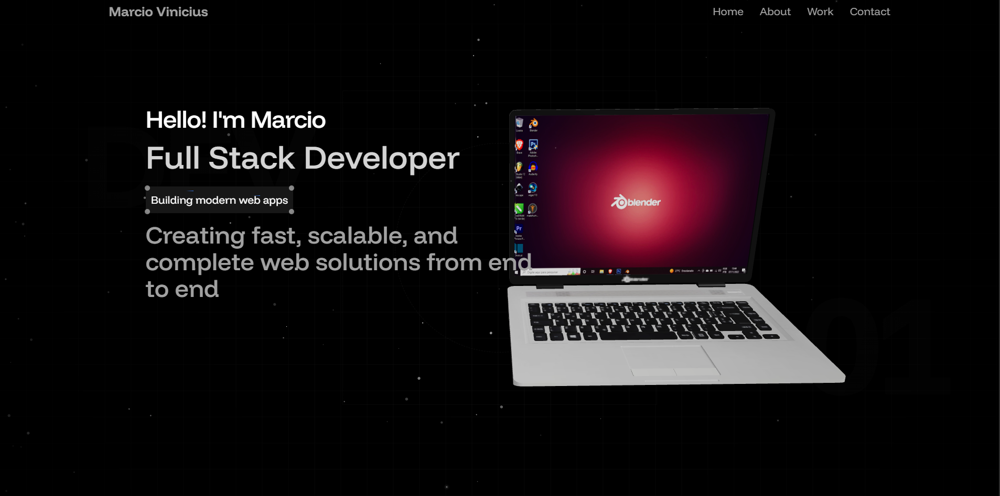
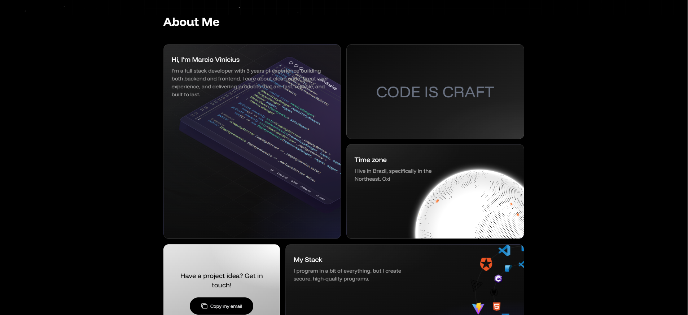
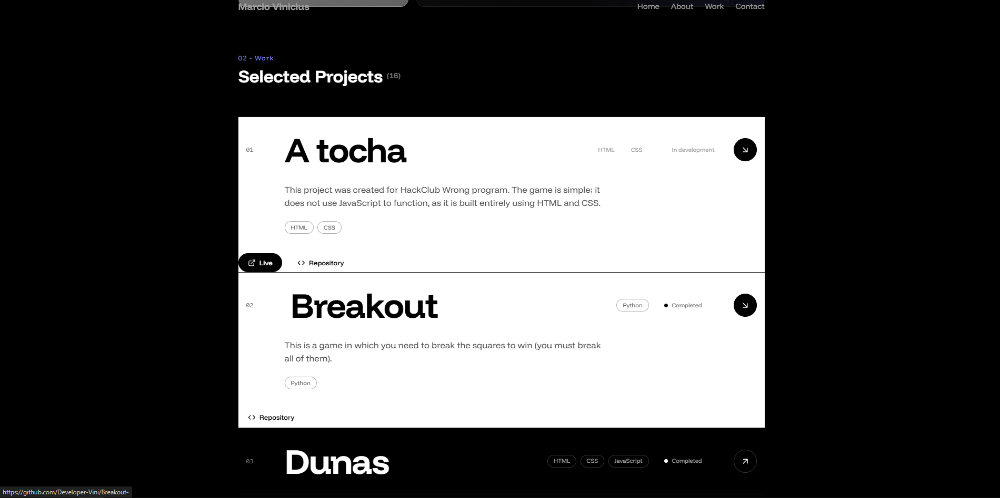
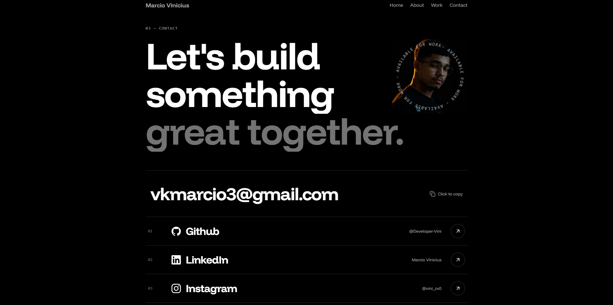
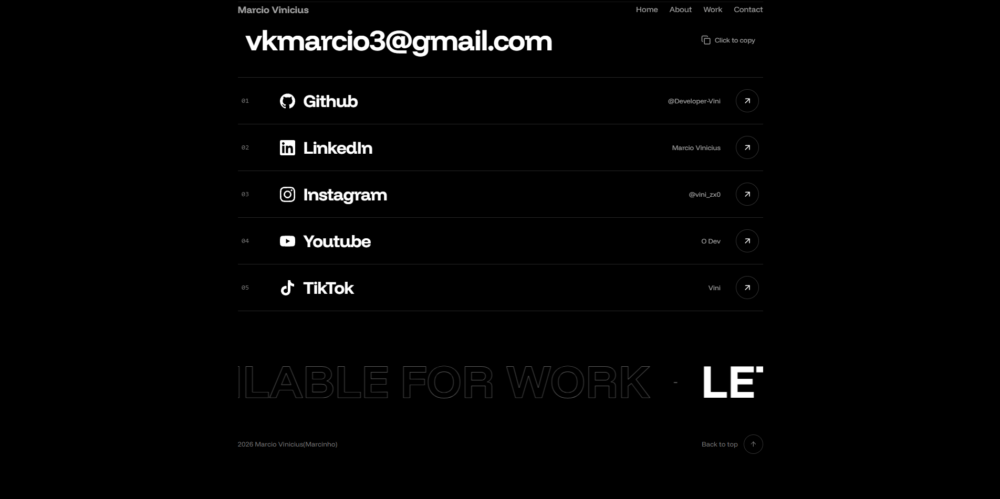

# ViniFolio

### My personal developer portfolio

[](https://react.dev)
[](https://vite.dev)
[](https://tailwindcss.com)
[](https://threejs.org)







# About the project

Vinifolio is the portfolio I created to showcase myself as a fullstack developer. The goal was to develop the site that felt like an interactive design piece rather than a simple template.

It is static single-page application consisting of four sections (home, about, project adn contact), structured entirely using React components and a small data file.

# Tech stack

| Area | Tools|
| ---  | ---  |
| Framework  | React |
| Build tool | Vite  |
| Styling    | Tailwind CSS 
| Animation  | Motion |
| 3D / Graphics | Three.js, React Three Fiber, Drei, Cobe, maath
| Icons | Lucide React |


## Getting started

### Requirements

- Node.js
- npm
- Git

### Installation 

```bash

# 1. clone the repository
git clone https://github.com/Developer-Vini/ViniFolio

# 2. enter the folder
cd ViniFolio

# 3. install dependencies
npm install 

# 4. start the dev server
npm run dev
```

Open the URL printed in the terminal (usually `http://localhost:5173`).

### Availble scripts

| Command | Description |
| --- | --- |
| `npm run dev` | Starts the development server with hot reload |
| `npm run build` | Creates an optimized production build in `dist/` |
| `npm run preview` | Serves the production build locally |
| `npm run lint` | Runs ESLint on the project |

## Customization guide

Want to use this as a base for your own portfolio? These are the places to edit

### Projects

Everythin lives in `src/data/projects.js`. Add an object to the array:

```js
{
    id: 17,
    title: "My new project",
    description: "What it does, in one or two sentences.",
    tags: ["React", "Node"],
    live: "https://...",             // optional; hidden if equal to `repo`
    repo: "https://github.com/...",
    videoYoutube: "https://...",     // optional; shows a "Watch demo" button
    status: "completed"              // or "in development"
}
```

### Personal info

- **Name and intro:** `src/section/Hero.jsx`, `HeroText` and `About.jsx`
- **Email:** `ButtonEmail.jsx` and `Contact.jsx`
- **Social links:** the `socials` array in `Contact.jsx`
- **Profile photo:** replace `public/assets/me.jpg`
- **Globe location:** the `markers` list in `Globe.jsx`

### Colors and animations

The palette and the marquee/orbit animations are declared inside the `@theme` block of `src/index.css`; Change the CSS variables there and whe whole site follows.

### 3D model

The laptop in the hero is `public/models/notebook.glb`, loaded in `Laptop.jsx`; Swap the file to use another model;

## Deploy 

The project is a static Vite app. The build command id `npm run build` and the output folder id `dist`.

### Vercel or Netlify

1. Import the repository
2. Build command: `npm run build`
3. Output directory: `dist`
4. Deploy

## Contact

- Email: [vkmarcio3@gmail.com](mailto:vkmarcio3@gmail.com)
- Github: [@Developer-Vini](https://github.com/Developer-Vini)

If you liked the project, a star on the repository is always appreciated.

## License
Distributed under the terms of the [LICENSE](./LICENSE) file.
 